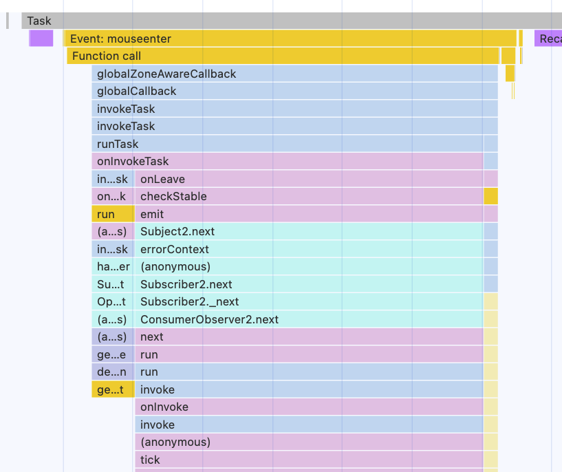
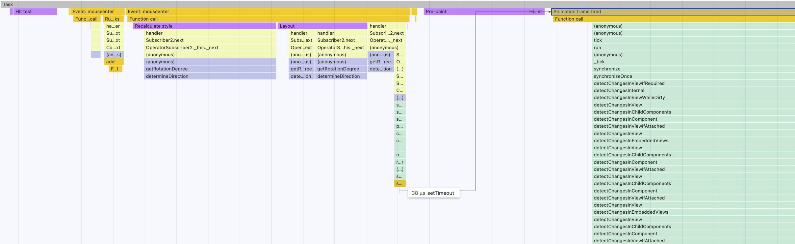

# ChangeDetection - Going zoneless Exercise

In this exercise you'll remove zone.js from the application. Zoneless change detection is the default since
Angular 21 — this app opts back into zone.js explicitly (`provideZoneChangeDetection()` in `src/main.ts`).

## 1. Remove zone.js

**1.1 Remove the zone provider**

Open `src/main.ts` and remove `provideZoneChangeDetection()` together with its import:

```ts
// src/main.ts

import { bootstrapApplication } from '@angular/platform-browser';

import { AppComponent } from './app/app.component';
import { appConfig } from './app/app.config';

bootstrapApplication(AppComponent, appConfig).catch((err) =>
  console.error(err),
);
```

> [!NOTE]
> `src/main.server.ts` (used by the SSR exercises) has the same provider — remove it there as well when you work
> with SSR.

**1.2 Remove the zone.js polyfill**

Without the provider, Angular doesn't use zone.js anymore — but it is still loaded and monkeypatches all browser APIs.
Remove the `polyfills` entry from the `build` target in `angular.json`:

```diff
// angular.json (projects > ws-ng-perf > architect > build > options)

"browser": "src/main.ts",
-"polyfills": [
-  "zone.js"
-],
"tsConfig": "tsconfig.app.json",
```

**1.3 Remove the dependency (optional)**

```bash
npm uninstall zone.js
```

Run `npx ng build`: the `polyfills` chunk is gone.

## 2. Observe what breaks

Restart the dev server (`angular.json` changed) and open the app: the list stays empty until you click
something. `MovieListPageComponent` writes `movies` in a `subscribe` — without zone.js, nobody tells Angular to
run change detection.

> [!NOTE]
> The movies show up anyway? Reload a few times — sometimes another change detection run (the side drawer's
> genres request) renders them by accident.

## 3. Fix it with signals

Open `src/app/movie/movie-list-page/movie-list-page.component.ts`:

* turn `movies` into a signal
* use `set` wherever it is written
* call the signal in the template

<details>
  <summary>MovieListPageComponent with signals</summary>

```diff
// src/app/movie/movie-list-page/movie-list-page.component.ts

- import { ChangeDetectionStrategy, Component, inject } from '@angular/core';
+ import { ChangeDetectionStrategy, Component, inject, signal } from '@angular/core';
```

```diff
- <movie-list [movies]="movies" />
+ <movie-list [movies]="movies()" />
```

```diff
- movies: TMDBMovieModel[] = [];
+ movies = signal<TMDBMovieModel[]>([]);
```

```diff
// both subscriptions in the constructor
).subscribe((movies) => {
-  this.movies = movies;
+  this.movies.set(movies);
});
```

</details>

The movies show up again.

> [!NOTE]
> The tilt effect needs the same treatment: the `TiltDirective` writes a plain field in a `fromEvent` subscription. With
> the [signals exercise](./change-detection%20-%20signals.md) done (`rotate` is a signal), hovering a card refreshes
> only that card: its counter (see [Dirty Check](./change-detection%20-%20Dirty%20Check.md)) increases, the parents stay,
> as nothing ticks the whole tree anymore.

<details>
  <summary>Flamecharts before and after zoneless</summary>

### Before zoneless

zone.js will have all those: 

globalZoneAwareCallback, onInvokeTask, onHasTask, runTask, scheduleTask,
run, invoke, onInvoke, invoke and then `tick` method.



### After zoneless

Without zone.js, Angular will schedule change detection using either `setTimeout` or `requestAnimationFrame`.

This makes it easier to test and debug your application using flamecharts.



</details>

