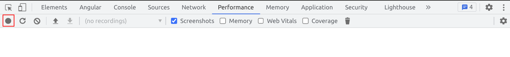
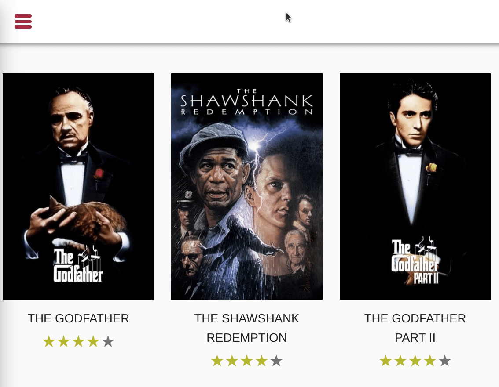
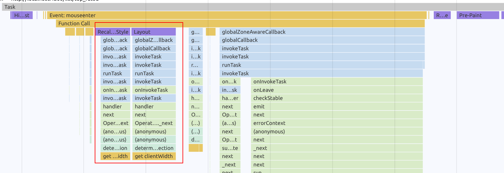

# CSS Performance - ResizeObserver & Forced Reflows

In this exercise you will learn how to measure & avoid unnecessary forced reflows. You will implement a
push-based architecture by leveraging advanced DOM APIs, the [ResizeObserver](https://developer.mozilla.org/en-US/docs/Web/API/ResizeObserver).

## 1. Improve Tilt Directive

### 1.0 Measure current state

Start off by measuring the current state of the animation that tilts the `movie-card` on hover.
Open your browser to any movie-list page (e.g. `http://localhost:4200/list/popular`) and start the dev tools with `F12` or `Ctrl + Shift + I`.

Do a recording of the animation and inspect the flame charts.



**Tilt Animation**


When analysing the flame charts, you should notice that there is a `layout` task involved
when querying for `getBoundingClientRect` or `clientWidth`.



### 1.1 Implement ResizeObserver

Your task now is to improve the performance of the animation by removing the need for layouting at all.

Go to the `TiltDirective` (`src/app/shared/tilt.directive.ts`) and make use of the `ResizeObserver` in order to get the dimensions of the directive pushed to in instead
of you having to query for it.

<details>
  <summary>Implement ResizeObserver</summary>

```ts
// src/app/shared/tilt.directive.ts

import { DestroyRef, Directive, ElementRef, inject, input } from '@angular/core';

// ...

export class TiltDirective {
  // ...

  private width = 0;

  constructor(private elementRef: ElementRef<HTMLElement>) {
    // the browser pushes the size, we never query it
    const observer = new ResizeObserver(([entry]) => {
      this.width = entry.contentRect.width;
    });
    observer.observe(this.elementRef.nativeElement);
    inject(DestroyRef).onDestroy(() => observer.disconnect());

    // ... existing rotate$ / reset$ code
  }
}
```

</details>

Feel free to add `console.log`s in order to see that the Observer is actually updating values when you resize the window :).

Now that we have the dimension pushed to us, we can use it in order to determine the direction of the animation.
`event.pageX` is relative to the document, so it needs the element's position (`getBoundingClientRect`) to be
comparable. `event.offsetX` is already relative to the element: compare it to half of the stored width.

<details>
  <summary>Adjust position determination</summary>

```ts
// src/app/shared/tilt.directive.ts

getRotationDegree(event: MouseEvent) {
  const pos = this.determineDirection(event.offsetX);
  return `rotate(${pos === 0 ? `${this.tiltDegree()}deg` : `${-this.tiltDegree()}deg`})`;
}

/**
 * returns 0 if entered from left, 1 if entered from right
 */
determineDirection(offsetX: number): 0 | 1 {
  return offsetX > this.width / 2 ? 1 : 0;
}
```
</details>

**Well done!!**

### 1.2 Measure the improvement

Do the measurement again, you should notice that the forced reflow is completely gone now as we are not querying for
any layout properties.
