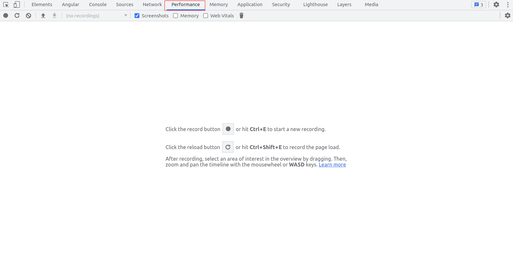
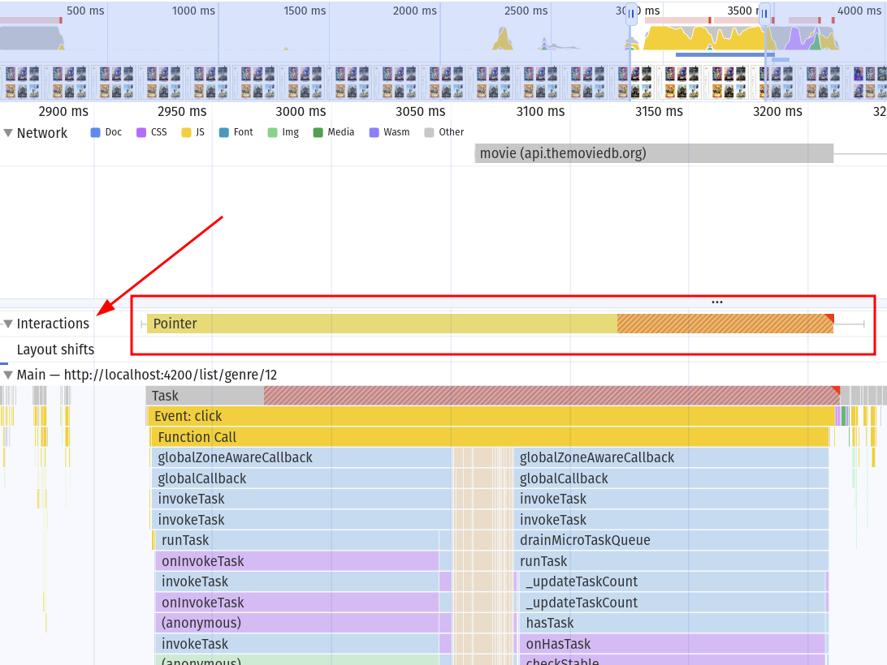
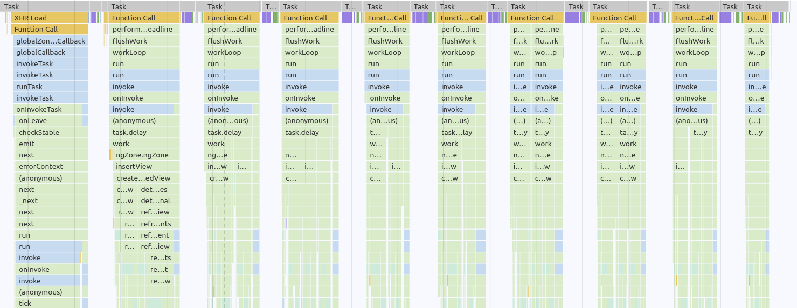

# Scheduling Exercise: Split Work

We learned about how we can use scheduling techniques in order to split up hard work in smaller
pieces. Let's go ahead and apply them to real `long tasks` of our application!

You will use the `dev tools Performance Tab` in order to search for `long tasks` and measure the outcome
of your applied changes. First you schedule and chunk plain JavaScript work by hand, then you let the
`rxFor` directive of `@rx-angular/template` do the same for your templates.

Serve the movies app and open your browser on the served `host:port`.

```bash
npm start
```

Also open the `Performance Tab` of the devtools.

<details>
  <summary>Show Help</summary>



</details>

## 1. Yield the navigation click

You already found it in the flame chart exercise: every click in the sidebar calls
`TrackingService.trackEvent` (`src/app/shared/tracking.service.ts`), a loop with 10 million iterations
that runs inside the click handler.

> [!NOTE]
> If you removed the loop in the AI performance skills bonus, restore it first
> (`git checkout -- src/app/shared/tracking.service.ts`) and make sure `AppShellComponent.trackNavigation`
> still calls `trackEvent`.

### 1.1 Measure the interaction

Select `4x slowdown` in the `CPU` throttling dropdown.

<details>
  <summary>CPU Throttling</summary>


</details>

Start a recording (`Record`, no reload), click `Top Rated` in the sidebar and stop the recording.

Inspect the `Interactions` track and the `Main` track. You should find a `long task` caused by the
`click` event, with `trackEvent` inside of it. Write down the interaction time.

<details>
  <summary>Show Help</summary>



</details>

### 1.2 Schedule the work

The tracking is not important for the user. It doesn't have to run before the browser paints the
result of the click.

Yield to the main thread before the work starts with `scheduler.yield()`. The rest of the function
continues in a new task, and the browser can paint the result of the click in between.

<details>
  <summary>Show Help</summary>

```ts
// src/app/shared/tracking.service.ts

async trackEvent(event: string) {
  // yield to the main thread
  await scheduler.yield();

  for (let i = 0; i < 10_000_000; i++) {
    const test = `${event}${i % 2 === 0}`;
    // pretend to do work;
  }
}
```

</details>

> [!NOTE]
> `scheduler.yield()` isn't available in every browser yet (Safari doesn't support it). There, use
> `await new Promise((resolve) => setTimeout(resolve))` instead: it gives the same result in this exercise.

Repeat the recording. The interaction time should drop a lot: the click task is short now, and the work
runs in a separate task after the browser painted the next frame.

But take a closer look at the `Main` track: the new task is still a `long task`. We didn't
reduce the work, we just moved it. Anything the user does while this task runs, has to wait for it.

### 1.3 Chunk the work

Split the loop into chunks that fit into the frame budget. Run the loop until a deadline of `~10ms`
is reached, then yield to the main thread with `scheduler.yield()` and continue with the next chunk.

<details>
  <summary>Show Help</summary>

```ts
// src/app/shared/tracking.service.ts

async trackEvent(event: string) {
  let i = 0;
  while (i < 10_000_000) {
    // yield to the main thread
    await scheduler.yield();

    const deadline = performance.now() + 10;
    while (i < 10_000_000 && performance.now() < deadline) {
      const test = `${event}${i % 2 === 0}`;
      i++;
    }
  }
}
```

</details>

Repeat the recording. The interaction time stays low and the `long task` is gone: the work is split
into many small tasks.

> [!TIP]
> Why `scheduler.yield()` and not `setTimeout`? The continuation of `scheduler.yield()` goes to the front
> of the task queue, so other scripts can't sneak in between your chunks. And nested `setTimeout` calls
> get clamped to a minimum delay of `4ms` after a few levels, which adds idle time between the chunks.

Well done! This is exactly what a scheduler does for you: run work until the budget is used up, then
give the browser a chance to handle input and paint.

## 2. Chunked List Rendering

Now let's apply the same idea to the rendering work of our templates.

Select `6x slowdown` in the `CPU` throttling dropdown.

Start a recording (`Record`, no reload), click `Top Rated` in the sidebar and stop the recording
when the new movies are visible.

Search for the task where `@for` creates the nodes for the `movie-cards` in the flame chart.
It is connected to the `XHR Load` / `fetch` event of the movie list request and causes lots of
`refreshView` calls.

<details>
  <summary>Show Help</summary>


</details>

With your knowledge about scheduling the identified pattern should already trigger some thoughts
about what we want to do with this one here :).
You should notice that there is a lot of repeated work done in a single task which could easily be split up.

Let's do so by switching from `@for` to `*rxFor` in the template of the `MovieListComponent`
(`src/app/movie/movie-list/movie-list.component.ts`, inline template). Import `RxFor` from
`@rx-angular/template/for`.

<details>
  <summary>Show Help</summary>

```html
<!-- src/app/movie/movie-list/movie-list.component.ts (template) -->

<movie-card
  *rxFor="let movie of movies(); trackBy: 'id'; let $index = index"
  [index]="$index"
  [routerLink]="['/movie', movie.id]"
  [loading]="favoritesLoading().has(movie.id)"
  [favorite]="favoriteMovieIds().has(movie.id)"
  (favoriteChange)="favoriteToggled.emit(movie)"
  [movie]="movie"
/>

@if (movies().length === 0) {
  <div class="no-movies">
    <fast-svg name="sad" size="50" />
    There are no movies to show
  </div>
}
```

</details>

The `rxFor` directive should make sure to render list items by keeping the frame budget of `60 fps` in mind.

Do another performance recording of the movie-list and search for the chunked list rendering pattern.

<details>
  <summary>Rx For Chunks</summary>



</details>

> [!NOTE]
> Don't scroll while recording. If the whole list keeps rebuilding after you switched the category and
> scrolled down, you found a bug in the `MovieListPageComponent`: the subscriptions of the old category
> are still alive and overwrite the list. You'll fix it later in the
> [Cancel Requests](./network-cancel-requests.md) exercise.

> [!TIP]
> Did you notice that the cards appear one after another, but nothing jumps around? Rendering in chunks
> only stays stable if the layout doesn't depend on how many items exist yet. The movie grid uses
> `auto-fill` columns (empty columns are kept) and the poster reserves its height with `aspect-ratio`.

Well done! You have successfully mastered the single-thread :-)

## 3. Bonus: The frame budget

`rxFor` renders as many items per task as fit into the frame budget. Compare a recording with `4x` and
`6x` CPU throttling: how many items end up in one chunk?

Now switch the `rxFor` to the `immediate` strategy and record again.

<details>
  <summary>Show Help</summary>

```html
<movie-card
  *rxFor="let movie of movies(); trackBy: 'id'; strategy: 'immediate'; let $index = index"
  ...
/>
```

</details>

The `immediate` strategy has a render deadline of `0ms`, so the whole list renders in one task again: the `long task`
is back. Revert to the default strategy when you're done.
